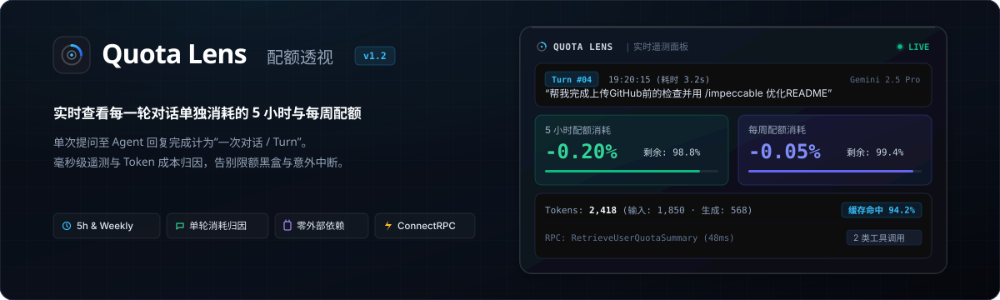
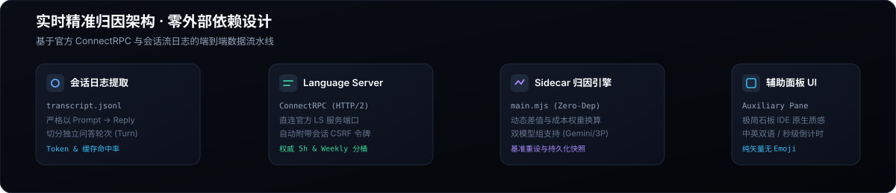

<p align="center">
  
</p>

<p align="center">
  <strong>专为 Google Antigravity 打造的原生会话配额透视与额度监控扩展</strong><br>
  实时查看每一轮提问单独消耗的 5 小时与每周配额，告别超额黑盒与意外中断。
</p>

<p align="center">
  <a href="README.md"><b>简体中文</b></a> &nbsp;|&nbsp; <a href="README_EN.md"><b>English</b></a>
</p>

---

## 为什么需要 Quota Lens？

在使用 Antigravity 进行深度 AI 结对编程时，用户往往只知道配额何时“突然耗尽”，却难以量化每一次复杂代码生成究竟消耗了多少额度。

| 评估维度 | 传统使用模式 (无监控) | 使用 Quota Lens |
| :--- | :--- | :--- |
| **单次提问消耗** | 完全未知，只能等到系统弹窗提示配额受限 | 实时呈现当前这一轮问答扣减的 5h 与每周精确百分比 |
| **成本与 Token 归因** | 无法评估多轮工具调用与长上下文的消耗占比 | 自动提取 Input / Output / Cache 命中率与加权成本 |
| **多模型组切换** | 无法分清 Gemini 与 Claude/GPT 谁占用了更多额度 | 支持 Gemini 与 3P 模型组一键分流查看 |
| **刷新预估** | 仅显示模糊时间，无法安排后续开发节奏 | 精准计算 5 小时与每周重置点，提供秒级递减倒计时 |
| **运行开销** | 依赖外部重型插件，甚至需要自搭服务 | **零外部 npm 依赖**，基于 Node 原生轻量 Sidecar 随开随用 |

---

## 核心特性

- **单轮交互独立配额归因（Turn Attribution）**
  - 严格以“用户发送一次提问 -> Agent 回复完成”为一个交互轮次（Turn）。
  - 顶部看板以高对比度卡片展示刚刚这一轮对话消耗的 5 小时与每周配额（如 `5h: -0.20% | 周: -0.05%`）。
  - 支持按最新/最早排序浏览交互清单，完整回溯提问引用、Token 细分与耗时。

- **多模型组双轨追踪**
  - 完整支持 **Gemini 模型组**（Flash / Pro）与 **Claude & GPT 3P 模型组**。
  - 单击即可在不同模型分桶之间平滑切换，分别洞悉各模型在同一会话中的扣减趋势。

- **动态倒计时与账户全局健康度**
  - 直接感知官方 Language Server 分桶状态（`gemini-5h`, `gemini-weekly`, `3p-5h`, `3p-weekly`）。
  - 秒级动态计算距离配额完全刷新的剩余时长，支持跨窗口重置自动识别。

- **极简 IDE 原生质感与中英双语 (i18n)**
  - 严格遵守低饱和度设计规范，全界面采用纯 SVG 矢量图标，**零 Emoji 杂质**。
  - 内置中英双语（`zh-CN` / `en-US`），支持浏览器语言自适应与右上角一键无缝切换。

---

## 核心算法与机制

<p align="center">
  
</p>

### 1. 权威数据源直连
无需安装任何外部 Agent 抓包工具。Quota Lens 后台 Sidecar 直连本地 Antigravity Language Server 的 ConnectRPC 服务：
```text
POST http://${ANTIGRAVITY_LS_ADDRESS}/exa.language_server_pb.LanguageServerService/RetrieveUserQuotaSummary
Headers: x-codeium-csrf-token: ${ANTIGRAVITY_CSRF_TOKEN}
```

### 2. 动态基准差值算法
- **会话初始基准**：记录会话初次加载时的初始分桶快照 $B = (B_{5h}, B_{weekly})$；
- **实时消耗计算**：随提问推进，对比当前实时配额 $C = (C_{5h}, C_{weekly})$，计算单会话总消耗 $\Delta = (B - C) \times 100\%$；
- **重置感知**：当检测到 $C > B$ 时，智能提示配额已刷新重置，支持一键“重设基准”重新标定统计起点。

### 3. 实测技术发现：4.0000 周期定律
经真实多轮调用严密推算验证：
$$\frac{\Delta 5\text{h}}{\Delta \text{Weekly}} \equiv 4.0000$$
即每周总配额容量在数值上严格等价于 **4 个完整的 5 小时突发配额周期**。

---

## 快速安装与使用

### 方式 1：直接克隆至插件目录（推荐）

打开终端，将本仓库克隆至 Antigravity 全局插件目录：

```bash
git clone https://github.com/pengyufeng/quota-lens.git ~/.gemini/config/plugins/quota-lens
```

### 方式 2：使用软链接（本地开发调试）

如果您已将仓库保存在本地工作区：

```bash
ln -s "$(pwd)" ~/.gemini/config/plugins/quota-lens
```

---

## 启用与面板打开

1. **启用插件**：
   - 打开 Antigravity 客户端；
   - 点击左侧活动栏底部的 **Customizations（扩展/自定义）** 图标；
   - 切换至 **Installed（已安装）** 标签页，找到 **Quota Lens** 并切换为 **开启 (Enable)**。
   - *(Antigravity 会自动唤起后台轻量 Sidecar 进程)*。

2. **在对话中展开面板**：
   - 进入任意对话；
   - 点击右上角的 **⋮（更多菜单）**；
   - 选择 **Extensions（扩展）** -> **Quota Lens**；
   - 右侧辅助面板（Auxiliary Pane）即会展开显示实时看板。

---

## 项目结构

```text
quota-lens/
├── plugin.json                       # 插件清单声明
├── LICENSE                           # MIT 开源许可证
├── assets/
│   ├── logo.svg                      # 极简取景环矢量图标
│   └── readme/
│       ├── hero.svg                  # 视网膜高清矢量头图 (带实时问答交互卡片)
│       └── architecture.svg          # 系统精准归因架构工作流图
└── sidecars/
    └── panel/
        ├── package.json              # Sidecar 元数据 (零外部 npm 依赖)
        ├── sidecar.json              # 辅助面板视图注册 (SIDECAR_UI_ENTRYPOINT_AUX_PANE)
        ├── main.mjs                  # 后端引擎：ConnectRPC 通信、差值计算、会话解析
        ├── index.html                # 前端结构：纯矢量 SVG 界面、多语言占位
        ├── app.js                    # 前端交互：i18n 引擎、轮询、倒计时、基准重设
        └── styles.css                # 原生主题自适应样式表 (深浅模式无缝适配)
```

---

## 开源协议

本项目采用 [MIT License](LICENSE) 许可协议。
